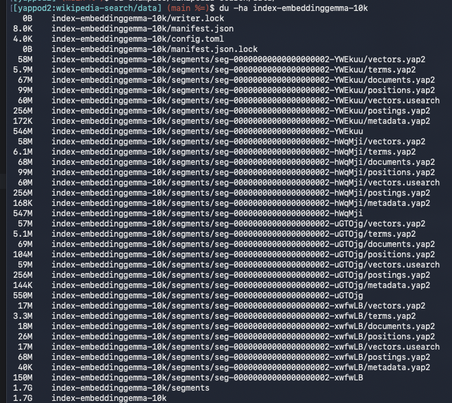

22年前に作ってた本番投入してた検索エンジン Yappod を大AI時代の今風に作り替えてる話

その昔 iYappo という検索サイトがありまして、メインの方は Rast を導入したり最終形態は MySQL + Senna で作っていたんですが、別口の方も C でまるっと書いて色々やってたことがあったんですね。

メインとは違う方の実験としても自前で検索エンジンを書いて[一般公開](https://web.archive.org/web/20040527031650/http://tech.yappo.jp/)していたりしてたんですが、色々あって放置して[とりあえずGitHub](http://github.com/yappo/yappod/)にだけ移してたという感じ。

今も当時の様子が現代に伝わる情報としては[Linux Conference 2005](http://lc.linux.or.jp/lc2005/03.html)の[全文検索BOF](https://web.archive.org/web/20060718045653/http://wiki.fdiary.net/kazuhiko/?lc2005-bof)で[発表した資料](https://web.archive.org/web/20060908140209/http://tech.yappo.jp/docs/LinuxConference2005.pdf)などがあったりします。

## LLM っていいですね

ここ数年で LLM 使ったら大体なんでも作れるようになってきてる。そう、思いついて作れる！と思ったものは多分何でも作れる。
LLM を使うのに必要なお金さえ払えたらあとは人間の時間と発想する能力さえあれば本当に何でも作れる。

そういった時代になったのが今です。いい時代ですね。

そんなこともあって20年以上前に作って放置してた検索エンジンを今風にブラッシュアップしてみることにしてみたのでした。

## Yappod とは

Cで書かれた全文検索エンジンソフトウェアです。

特徴としては

- インデックスのメインストレージは BerkeleyDB を使ってる
- よくある普通の N-Gram 検索
- 自ノードで保持してるインデックスを検索する yappod_core と、それらを集約してユーザ側のアプリとの BFF になる yappod_front がある
- 基本的にインデックスは全部作って入れ替える感じで更新処理はあんまり考えてない

といった形のものでした。 yappod 単独の仕様はこんな感じですが、 Web サイトを自律的に収集する web crowler やページごとの関係値や iYappo 側のスコア情報などを加味したスコアリング処理などを別口でつけてたけど、公開されてるものには含めてないのでオーパーツ化しています。

## Yappod2 を作ってる

本題ですが、上記の22年以上前の検索エンジンですが令和の大AI時代に合わせて現代風の検索エンジンとしてリフォームしているのが[Yappod2](https://github.com/yappo/yappod2)となっています。

特徴としては

- yappod_core, yappod_front の構成は維持
- ストレージは独自形式を採用
- ベクトル検索に対応
  - 通常のキーワード検索とベクトル検索を並列処理してスコアリングする
- RAG として LLM に渡すためのデータセットを返せる
- インデックスのコンパクションツール追加
- [充実したドキュメント！](https://github.com/yappo/yappod2/tree/main/docs)
- [充実したリファレンス実装！](https://github.com/yappo/yappod2/tree/main/examples)
  - local file からインデックスを生成します
  - Wikipedia data からインデックスを生成します
  - 各種検索機能を試すための Web アプリを起動できます

などなどがあります。どうやら現在の設計だと yappod_front から使えるのが1個の yappod_core だけだったりと若干分散性能無くなったけど、それはおいおい。。

サンプルの Web 実装では、ベクトル検索やら文書で検索して検索結果として Google の AI モードのような AI が回答を出してくれる感じの UX を提供しています。回答生成の精度がなんか怪しいのでもうちょいチューニングしたいところ。 

Wikipedia から1万件の戦国時代カテゴリのページのフル本文を収集して768次元のベクトルインデックスを作ったらだいたい1.7GBくらいのインデックスになります。

## Local LLM でも Yappod2 の機能が試せます

自分の場合だと MacBook Air M4 に 32GB メモリ積んでて LM Studio で Local LLM を試すことを良くやってるんですが、 EmbeddingGemma を入れて Yappod のインデックス用のベクトルを作ったり、キーワード検索で使うベクトルを作らせるなどやっても、だいぶ早くベクトル生成できてる感じです。

RAG を LLM に渡して回答を作らせるところは Gemma4-26B-A4B でやってるけど、推論は早いけど出力がまあ律速ですね。。
LMX よりも GGUF のが早かった気がするけど LMX のチューニングちゃんとできてないせいかもしれない。。

一応使ってる時のデモ動画として以下のような感じです。 GUFF のが10秒くらいで回答生成できてたが。。(これはLMX)

<video src="yappod2-demo.mov" controls playsinline preload="metadata" style="width: 100%; height: auto;">
  [yappod2-demo.mov](yappod2-demo.mov)
</video>

## いまこんなことをする意味

意味なんてないです。そこに作りかけだった素体と作ってくれるAIがいたからです。
本運用停止して四半世紀近く経ったプロダクトなんで朽ち果てたまま放置されるのが常ですが

「いつかはいい感じにしたいなでも手で自分で作るのめんどいな労力かけてまで使うこともないな。。」と放置してたものが、AIによって誰でもいい感じに最新の動向踏まえた実装に置き換えられる、一定の技術的知識があればそれこそ無限大に思ったものが作り出せる現代はとても良いものですね。
