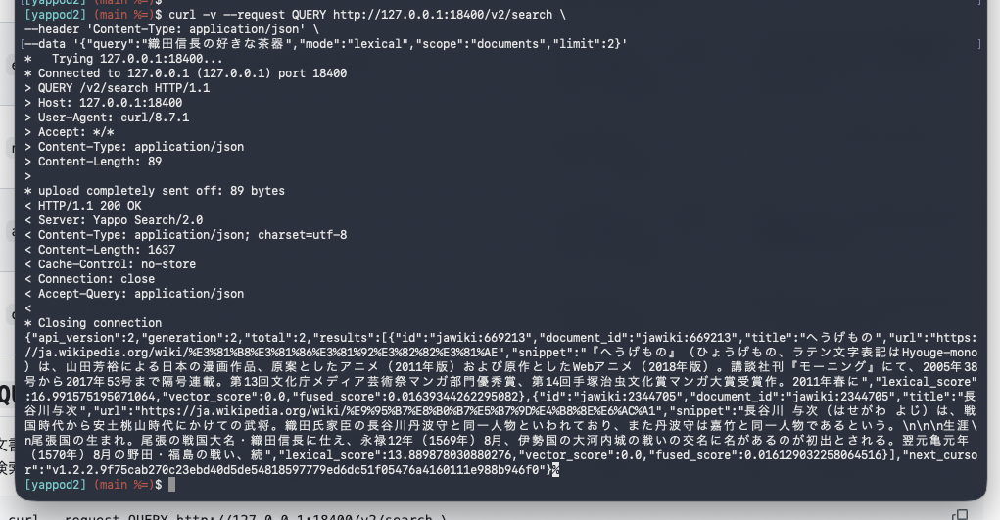

RF10080 の QUERY method を Yappod に実装しました

これといって強い意志は無かったんですが先月[RFC10080](https://datatracker.ietf.org/doc/html/rfc10008)が出たってことでせっかくなので Yappod に実装してみようと思って実装してみました。

front server の検索APIなどが QUERY に対応してます。一旦後方互換のために POST でも動くように残してあります。

## 内部通信も変更

yappod は frontend server と backend server の二段構えになっていて、元々は index を受け持ってる backend server を複数台並べて分散処理ができるような設計だったんですが

どういうわけか Yappod2 にしていく過程で Codex が「いったん分散構成外しとこ？」とか提案してきたり

旧 yappod は front <-> core の通信が simple text だったんだけど、 Codex が「バイナリ通信ベースのが堅牢で早いぜ！」みたいな提案をするもんだからホイホイおっけーだしてしまって

なんで front/core で別れてるんだかわからない独自プロトコルになってたんです。 AI の提案をホイホイ聞いてちゃダメですね。

元々は front/core を分離してスケールアウトしやすくしたいというのもあって、 front <-> core の通信も独自バイナリから HTTP/1.1 に変更しました。ついでに QUERY method で検索するように。

現状としてはアプリ側から直接 core 叩いても良いっていうか front がいるだけオーバヘッドあるけど、重めな core node を水平/垂直で並べて front と core の間に load balancer 入れて分散。
さらに front 側も複数にして。。みたいなスケールアウトしやすくしとこう。という感じで刷新しときました。

## とはいえ

そんなスケールアウトしまくる用途で使われる気がしないけど、趣味なんで。。

あと RFC を元に AI に作らせると手戻り全然なくって便利ですね。 RFC はやっぱすごい。